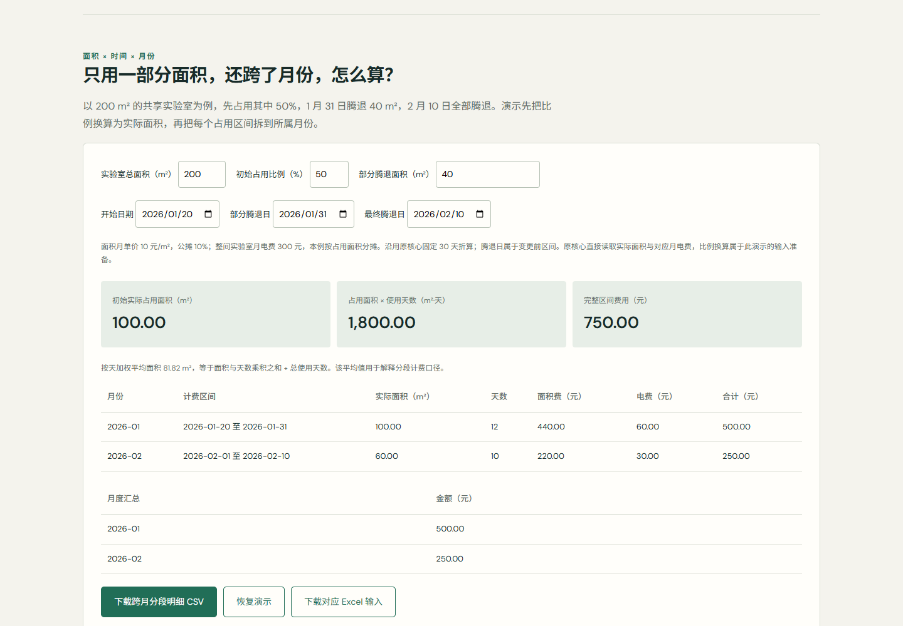

# 空间费用核算与管理

将申请与腾退事件转为可追溯的分段费用，输出课题组、月份和资源明细。

**[打开在线交互演示](https://zhaoxiaoye1.github.io/space-billing-workflow/)** · [查看演示页面源文件](docs/index.html)


## 解决的问题

- 来源表格结构不一，需要先形成可计算的输入。
- 部分腾退与跨期占用导致整月静态核算不适用。
- 总额需要回溯到资源、时间区间和收费规则。



## 如何查看

在线演示无需安装。GitHub 的文件列表下方会直接显示本说明和预览图。点击“打开在线交互演示”可操作页面。

```bash
pip install -r requirements.txt
python src/run_demo.py
```

输出为 `outputs/billing_report.xlsx` 与分段 CSV。在线试算为独立讲解示例，完整 Python 示例使用实际项目核心。

## 面积与跨月分配

实际核心按占用面积、收费参数和使用天数计费，再按日历月拆分。输入准备阶段将占用比例换算为实际面积，并按约定分摊电费，再交由计费核心生成分段与月度结果。

样例为 200 m² 共享实验室，初始使用 50%；2026-01-20 开始，1 月 31 日腾退 40 m²，2 月 10 日全退。原核心生成 1 月 500 元、2 月 250 元，合计 750 元。采用固定 30 天折算，与实际自然月天数分配分别说明。

```bash
python src/build_dashboard_demo.py
```

## 决策智慧大屏

[打开完整大屏](https://zhaoxiaoye1.github.io/space-billing-workflow/dashboard.html)。复用实际交付项目的前端和指标提取函数，使用重新构造的输入与容量。支持月份切换、费用结构、课题组排名、中心对比、月度趋势和资源计数。资源占用率按“当月计费资源编号数 ÷ 演示容量”计算。

在线大屏自动读取仓库内的样板 JSON，无需选择本地文件。项目页直接嵌入可操作的大屏。

## 我的工作与 AI 协作

赵小也负责需求梳理、业务规则、方案选择、结果核查与交付，使用 AI 编码工具辅助实现、调试与展示制作。

## 演示说明

机构、课题组、资源编号和金额使用构造的演示数据。计费采用固定 30 天折算，支持按事件分段与按自然月归集。


## 区间计费规则

腾退日计入变更前区间，次日进入剩余占用状态。[查看计费规则与核验](PUBLIC_CHANGES.md)。
